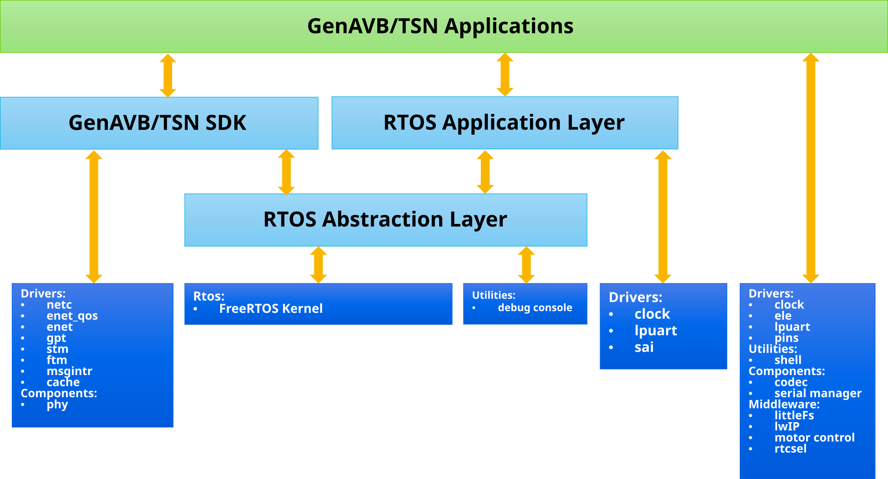

# NXP GenAVB/TSN Stack FreeRTOS Release Notes

## 1. Release Description

The GenAVB/TSN Stack FreeRTOS **8_4_0** release is a set of components allowing both **Evaluation** and **Development** of TSN functionality on NXP i.MX RT Series and MCX E Series (see [Release Content](#2-release-content) for the exact list of supported platforms).

The GenAVB/TSN FreeRTOS **Evaluation** support includes all the necessary binaries and documents to assist users in setting up and running TSN demonstrators. This includes TSN example applications making usage of the GenAVB/TSN API. The related API documentation is also provided.

The GenAVB/TSN FreeRTOS **Development** support includes elements allowing integration of the GenAVB/TSN stack in a customized reference platform. This includes a MCUXpresso SDK patch for integration with the MCUXpresso SDK build environment, and related sources/binaries for regeneration of application image binaries.

---

## 2. Release Content

In the following release content description, the supported target platforms and configurations are as follows:

- **PLATFORM**:
  - **FRDM-MCXE247**: MCX E24 Development board
  - **FRDM-MCXE31B**: MCX E31B Development board
  - **FRDM-MCXE32B**: MCX E32B Development board
  - **MIMXRT1170-EVKB**: i.MX RT1170 Evaluation board
  - **MIMXRT1180-EVK**: i.MX RT1180 Evaluation board
  - **FRDM-IMXRT1186**: i.MX RT1186 Development board

- **CONFIG**:
  - gPTP endpoint role for MCX E24
  - TSN endpoint role for i.MX RT1170
  - TSN bridge role for i.MX RT1180 and i.MX RT1186
  - TSN endpoint role for MCX E31B, MCX E32B, i.MX RT1180 and i.MX RT1186
  - DSA ENETC CPU port for i.MX RT1180
  - DSA Switch CPU port for i.MX RT1180

- **MCUXpresso SDK version**:
  - v26.09.00 for MCX E24 FRDM
  - v26.09.00 for MCX E31B FRDM
  - v26.09.00 for MCX E32B FRDM
  - v26.09.00 for i.MX RT1170 EVKB
  - v26.09.00 for i.MX RT1180 EVK
  - v26.09.00 for i.MX RT1186 FRDM

The GenAVB/TSN FreeRTOS package is distributed through two different channels: GitHub and MCUXpresso SDK Builder site.

The GenAVB/TSN SDK package includes source code for all the AVB/TSN protocol stacks and public API's for application development. The package integrates with MCUXpresso SDK drivers and provides build system integration with the MCUXpresso SDK development environment(s).

The GenAVB/TSN application packages include full source code for example AVB and TSN applications. See GenAVB/TSN MCUXpresso User's Guide (GAVBMCUXUG) for more details.

  

<em>GenAVB/TSN FreeRTOS Distribution Components</em>

### 2.1. GitHub Package

The GitHub package, composed of several git repositories and a top-level manifest, is intended for the GNU ARM Embedded toolchain development environment. The package includes the following components:

- **[GenAVB/TSN SDK](https://github.com/NXP/GenAVB_TSN)**
  - GenAVB/TSN SDK for all supported configurations and devices
- **[GenAVB/TSN FreeRTOS Application code](https://github.com/NXP/GenAVB_TSN-rtos-apps)**
  - GenAVB/TSN example applications source code
  - GenAVB/TSN FreeRTOS Release Notes (This document)
    - Major changes since the last release
  - [GenAVB/TSN FreeRTOS Evaluation User's Guide (GAVBFREVALUG)](https://github.com/NXP/GenAVB_TSN-rtos-apps/releases/download/8_4_0/NXP_GenAVB_TSN_Stack_FreeRTOS_Eval_User_s_Guide-8_4_rev0.pdf)
    - User information for running evaluation setups
  - [GenAVB/TSN MCUXpresso User's Guide (GAVBMCUXUG)](https://github.com/NXP/GenAVB_TSN-rtos-apps/releases/download/8_4_0/NXP_GenAVB_TSN_MCUXpresso_User_s_Guide_8_4_rev0.pdf)
    - User information for using MCUXpresso to build GenAVB/TSN applications
  - [GenAVB/TSN FreeRTOS Programmer's Reference Guide (html format)](https://github.com/NXP/GenAVB_TSN/releases/download/8_4_0/GenAVB_TSN_Programmer_s_Reference_Guide.zip)
    - GenAVB/TSN Stack API information for programmers
  - [GenAVB/TSN Motor Control Application Notes (TSNMCAN01)](https://github.com/NXP/GenAVB_TSN-rtos-apps/releases/download/8_4_0/NXP_TSN_Motor_Control_Application_Notes_rev5.pdf)
    - User Information to enable motor control on i.MX RT1170 and i.MX RT1180 EVK's
  - [GenAVB/TSN FreeRTOS Readme](https://github.com/NXP/GenAVB_TSN-rtos-apps/blob/master/README.md)
    - Top level build instructions
- **[RTOS Abstraction Layer](https://github.com/NXP/rtos-abstraction-layer)**
- **[RTOS Common Application code](https://github.com/NXP/rtos-apps)**

### 2.2. Pre-compiled Binaries

The following pre-compiled example application binary images are provided as GitHub release assets:

- **MCX E247 FRDM**
  - binaries: [`genavb-tsn_app-FreeRTOS_mcxe247-8_4_0.zip`](https://github.com/NXP/GenAVB_TSN-rtos-apps/releases/download/8_4_0/genavb-tsn_app-FreeRTOS_mcxe247-8_4_0.zip)
    - TSN example application binary image that can be used for MCX E24 flash boot
- **MCX E31B FRDM**
  - binaries: [`genavb-tsn_app-FreeRTOS_mcxe31b-8_4_0.zip`](https://github.com/NXP/GenAVB_TSN-rtos-apps/releases/download/8_4_0/genavb-tsn_app-FreeRTOS_mcxe31b-8_4_0.zip)
    - TSN example application binary image that can be used for MCX E31B flash boot
- **MCX E32B FRDM**
  - binaries: [`genavb-tsn_app-FreeRTOS_mcxe32b-8_4_0.zip`](https://github.com/NXP/GenAVB_TSN-rtos-apps/releases/download/8_4_0/genavb-tsn_app-FreeRTOS_mcxe32b-8_4_0.zip)
    - TSN example application binary image that can be used for MCX E32B flash boot
- **i.MX RT1170 EVKB**
  - binaries: [`genavb-tsn_app-FreeRTOS_rt1176_cm7-8_4_0.zip`](https://github.com/NXP/GenAVB_TSN-rtos-apps/releases/download/8_4_0/genavb-tsn_app-FreeRTOS_rt1176_cm7-8_4_0.zip)
    - TSN example application binary image that can be used for i.MX RT1170 Cortex-M7 flash boot
- **i.MX RT1180 EVK**
  - binaries: [`genavb-tsn_app-FreeRTOS_rt1189_cm33-8_4_0.zip`](https://github.com/NXP/GenAVB_TSN-rtos-apps/releases/download/8_4_0/genavb-tsn_app-FreeRTOS_rt1189_cm33-8_4_0.zip)
    - TSN example application binary image(s) that can be used for i.MX RT1180 Cortex-M33 ram or flash boot
  - binaries: [`genavb-tsn_app-FreeRTOS_rt1189_cm7-8_4_0.zip`](https://github.com/NXP/GenAVB_TSN-rtos-apps/releases/download/8_4_0/genavb-tsn_app-FreeRTOS_rt1189_cm7-8_4_0.zip)
    - TSN example application binary image that can be used for i.MX RT1180 Cortex-M7 ram or flash boot
  - binaries: [`genavb-dsa_enetc-FreeRTOS_rt1189_cm33-8_4_0.zip`](https://github.com/NXP/GenAVB_TSN-rtos-apps/releases/download/8_4_0/genavb-dsa_enetc-FreeRTOS_rt1189_cm33-8_4_0.zip)
    - DSA example application binary image using ENETC as CPU port that can be used for i.MX RT1180 Cortex-M33 ram or flash boot
  - binaries: [`genavb-dsa_switch-FreeRTOS_rt1189_cm33-8_4_0.zip`](https://github.com/NXP/GenAVB_TSN-rtos-apps/releases/download/8_4_0/genavb-dsa_switch-FreeRTOS_rt1189_cm33-8_4_0.zip)
    - DSA example application binary image using one of the switch port as CPU port that can be used for i.MX RT1180 Cortex-M33 ram or flash boot
- **i.MX RT1186 EVK**
  - binaries: [`genavb-tsn_app-FreeRTOS_rt1186_cm33-8_4_0.zip`](https://github.com/NXP/GenAVB_TSN-rtos-apps/releases/download/8_4_0/genavb-tsn_app-FreeRTOS_rt1186_cm33-8_4_0.zip)
    - TSN example application binary image(s) that can be used for i.MX RT1186 Cortex-M33 ram or flash boot
  - binaries: [`genavb-tsn_app-FreeRTOS_rt1186_cm7-8_4_0.zip`](https://github.com/NXP/GenAVB_TSN-rtos-apps/releases/download/8_4_0/genavb-tsn_app-FreeRTOS_rt1186_cm7-8_4_0.zip)
    - TSN example application binary image(s) that can be used for i.MX RT1186 Cortex-M7 ram or flash boot

---

## 3. Release Notes

### 3.1. General

- New features
  - Add support for MCX E32B

### 3.2. MCX E247

- New features
  - MCUXpresso SDK v26.09.00

### 3.3. MCX E31B

- New features
  - MCUXpresso SDK v26.09.00
  - Motor Control support as IO Device

### 3.4. MCX E32B

- New features
  - MCUXpresso SDK v26.09.00
  - Motor Control support as IO Device

### 3.5. i.MX RT1170

- New features
  - MCUXpresso SDK v26.09.00
- Fixes
  - Cortex-M7 core flashing with Jlink and Linkserver
  
### 3.6. i.MX RT1180

- New features
  - MCUXpresso SDK v26.09.00

### 3.7. i.MX RT1186

- New features
  - MCUXpresso SDK v26.09.00

### 3.8. Feature matrix

#### 3.8.1. GenAVB/TSN SDK

| Feature            | Capability                                                                                         | MCX E24 | MCX E31B | MCX E32B | i.MX RT1170 | i.MX RT1180 | i.MX RT1186 |
| ------------------ | -------------------------------------------------------------------------------------------------- | :-----: | :------: | :------: | :---------: | :---------: | :---------: |
| AVB/TSN Protocols  | gPTP - Generalized Precision Time Protocol (IEEE 802.1AS-2020)                                     |    ●    |    ●     |     ●    |      ●      |      ●      |      ●      |
|                    | AVTP - Audio/Video Transport Protocol (IEEE 1722-2016)                                             |         |          |          |      ●      |             |             |
|                    | FQTSS - Forwarding and Queuing for Time-Sensitive Streams (IEEE 802.1Q-2018, section 34)           |         |          |          |      ●      |      ●      |      ●      |
|                    | SRP - Stream Reservation Protocol (IEEE 802.1Q-2018, section 35)                                   |         |    ●     |     ●    |      ●      |      ●      |      ●      |
|                    | AVDECC - Audio/Video Discovery, Enumeration, Connection Management, and Control (IEEE 1722.1-2013) |         |          |          |      ●      |             |             |
|                    | EST - Enhancements for Scheduled Traffic (IEEE 802.1Qbv-2015)                                      |         |    ●     |     ●    |      ●      |      ●      |      ●      |
|                    | FP - Frame Preemption (IEEE 802.3br-2016/IEEE 802.1Qbu-2016)                                       |         |    ●     |     ●    |      ●      |      ●      |      ●      |
|                    | PSFP - Per Stream Filtering and Policing (IEEE 802.1Qci-2017)                                      |         |          |          |             |      ●      |      ●      |
|                    | FRER - Frame Replication and Elimination for Reliability (IEEE 802.1CB-2017)                       |         |          |          |             |      ●      |      ●      |
|                    | HSR - High-availability Seamless Redundancy (IEC 62439-3:2022)                                     |         |          |          |             |      ●      |      ●      |
| gPTP stack         | PTP End Instance (Endpoint)                                                                        |    ●    |    ●     |     ●    |      ●      |      ●      |      ●      |
|                    | PTP Relay Instance (Bridge)                                                                        |         |          |          |             |      ●      |      ●      |
|                    | Grandmaster PTP Instance                                                                           |    ●    |    ●     |     ●    |      ●      |      ●      |      ●      |
|                    | Multiple gPTP domain                                                                               |    ●    |    ●     |     ●    |      ●      |      ●      |      ●      |
| AVTP stack         | IEC 61883-6: AM824/MBLA, 32-bit float, 32-bit integer                                              |         |          |          |      ●      |             |             |
|                    | AVTP Audio Format (AAF)                                                                            |         |          |          |      ●      |             |             |
|                    | IEC 61883-4: MPEG2-TS container for H.264, MPEG-2, MJPEG, AAC....                                  |         |          |          |      ●      |             |             |
|                    | Compressed Video Format (CVF): MJPEG, Listener only, for MPC5604EKIT support                       |         |          |          |      ●      |             |             |
|                    | Compressed Video Format (CVF): H264                                                                |         |          |          |      ●      |             |             |
|                    | Clock Reference Format (CRF)                                                                       |         |          |          |      ●      |             |             |
|                    | AVTP Control Format (ACF)                                                                          |         |          |          |      ●      |             |             |
|                    | Up to 32 audio channels per audio stream (IEC61883-6 and AAF)                                      |         |          |          |      ●      |             |             |
|                    | Up to 8 AVTP streams                                                                               |         |          |          |      ●      |             |             |
|                    | Hardware Media Clock Recovery                                                                      |         |          |          |      ●      |             |             |
| SRP stack          | Endpoint                                                                                           |         |    ●     |     ●    |      ●      |             |             |
|                    | Bridge                                                                                             |         |          |          |             |      ●      |      ●      |
| Public control API's | AVTP streaming API's                                                                             |         |          |          |      ●      |             |             |
|                    | AVDECC control API's                                                                               |         |          |          |      ●      |             |             |
|                    | Bridge Filtering Data Base (FDB) and VLAN Registration (IEEE 802.1Q-2018) control API's            |         |          |          |             |      ●      |      ●      |
|                    | EST control API's                                                                                  |         |    ●     |     ●    |      ●      |      ●      |      ●      |
|                    | FP control API's                                                                                   |         |    ●     |     ●    |      ●      |      ●      |      ●      |
|                    | PSFP control API's                                                                                 |         |          |          |             |      ●      |      ●      |
|                    | FRER control API's                                                                                 |         |          |          |             |      ●      |      ●      |
|                    | Layer 2 socket API's                                                                               |    ●    |    ●     |     ●    |      ●      |      ●      |      ●      |
|                    | gPTP clock and timer service API's                                                                 |    ●    |    ●     |     ●    |      ●      |      ●      |      ●      |
| RTOS               | FreeRTOS 11.1.0                                                                                    |    ●    |    ●     |     ●    |      ●      |      ●      |      ●      |
| Development Environment | MCUXpresso SDK 26.09                                                                          |    ●    |    ●     |     ●    |      ●      |      ●      |      ●      |
|                    | GNU ARM Embedded toolchain and CMake command line                                                  |    ●    |    ●     |     ●    |      ●      |      ●      |      ●      |
|                    | VSCode IDE v26.3.55                                                                                |    ●    |    ●     |     ●    |      ●      |      ●      |      ●      |
|                    | IAR Embedded Workbench version 9.60.3 or above                                                     |         |          |          |             |             |             |
|                    | Linux Host                                                                                         |    ●    |    ●     |     ●    |      ●      |      ●      |      ●      |
|                    | Windows Host                                                                                       |    ●    |    ●     |     ●    |      ●      |      ●      |      ●      |

#### 3.8.2. FreeRTOS Example Applications

GenAVB/TSN stack capabilities are described in the table below.

| Feature                  | Capability                                                    | FRDM-MCXE247 | FRDM-MCXE31B | FRDM-MCXE32B | i.MX RT1170 EVKB CM7 | i.MX RT1180 EVK CM33 | i.MX RT1180 EVK CM7 | i.MX RT1186 FRDM CM33 | i.MX RT1186 FRDM CM7 |
| ------------------------ | ------------------------------------------------------------- | :----------: | :----------: | :----------: | :------------------: | :------------------: | :-----------------: | :-------------------: | :------------------: |
| Example applications     | gPTP Endpoint                                                 |      ●       |              |              |                      |                      |                     |                       |                      |
|                          | TSN Endpoint                                                  |              |      ●       |       ●      |         ●            |          ●           |          ●          |           ●           |          ●           |
|                          | TSN Bridge                                                    |              |              |              |                      |          ●           |                     |           ●           |                      |
|                          | DSA ENETC CPU port                                            |              |              |              |                      |          ●           |                     |                       |                      |
|                          | DSA Switch CPU port                                           |              |              |              |                      |          ●           |                     |                       |                      |
| TSN Endpoint application | Network Only                                                  |              |      ●       |       ●      |         ●            |          ●           |          ●          |           ●           |          ●           |
|                          | Motor Controller                                              |              |              |              |         ●            |                      |          ●          |                       |          ●           |
|                          | Motor I/O device                                              |              |      ●       |       ●      |         ●            |                      |          ●          |                       |                      |
| TSN Bridge application   | Run time command line                                         |              |              |              |                      |          ●           |                     |           ●           |                      |
|                          | Permanent configuration (flash based)                         |              |              |              |                      |          ●           |                     |           ●           |                      |
|                          | Boot configuration (applying permanent configuration at boot) |              |              |              |                      |          ●           |                     |           ●           |                      |
| TCP/IP stack             | lwIP 2.2.1_rev6                                               |      ●       |      ●       |       ●      |         ●            |          ●           |   ●1     |           ●           |          ●           |
| Development Environment  | MCUXpresso SDK 26.09                                          |      ●       |      ●       |       ●      |         ●            |          ●           |          ●          |           ●           |          ●           |
|                          | GNU ARM Embedded toolchain and CMake command line             |      ●       |      ●       |       ●      |         ●            |          ●           |          ●          |           ●           |          ●           |
|                          | VSCode v26.3.55                                               |      ●       |      ●       |       ●      |         ●            |          ●           |          ●          |           ●           |          ●           |
|                          | IAR Embedded Workbench version 9.60.3 or above                |              |              |              |                      |          ●           |                     |           ●           |                      |
|                          | Linux Host                                                    |      ●       |      ●       |       ●      |         ●            |          ●           |          ●          |           ●           |          ●           |
|                          | Windows Host                                                  |      ●       |      ●       |       ●      |         ●            |          ●           |          ●          |           ●           |          ●           |
| VS Code                  | Ram build                                                     |              |              |              |         ●            |          ●           |          ●          |           ●           |          ●           |
|                          | Flash build                                                   |      ●       |      ●       |       ●      |         ●            |          ●           |          ●          |           ●           |          ●           |
| IAR IDE                  | Ram build                                                     |              |              |              |                      |          ●           |                     |                       |                      |
|                          | Flash build                                                   |              |              |              |                      |          ●           |                     |                       |                      |
| Flash build              | Boot from external Quad SPI flash                             |              |              |              |         ●            |          ●           |          ●          |           ●           |          ●           |
|                          | Boot from internal flash                                      |      ●       |      ●       |       ●      |                      |                      |                     |                       |                      |
|                          | TCM used for code, stack, heap and data                       |              |              |              |         ●            |          ●           |          ●          |           ●           |          ●           |
|                          | OCRAM used for code and network buffers                       |              |              |              |         ●            |          ●           |          ●          |           ●           |          ●           |
|                          | SDRAM used for code and network buffers                       |              |              |              |                      |                      |                     |                       |                      |
| Ram build                | Code download through debug interface                         |              |              |              |         ●            |          ●           |          ●          |           ●           |          ●           |
|                          | TCM used for code, stack, heap and data                       |              |              |              |         ●            |          ●           |          ●          |           ●           |          ●           |
|                          | OCRAM used for code and network buffers                       |              |              |              |         ●            |          ●           |          ●          |           ●           |          ●           |

¹ Motor I/O device build only.

---

## 4. Known Issues

| Issue description                                                                                                                            | Remarks                                                                                                                                                                                                                                                             |
| -------------------------------------------------------------------------------------------------------------------------------------------- | ----------------------------------------------------------------------------------------------------------------------------------------------------------------------------------------------------------------------------------------------------------------- |
| i.MX RT1180 Per-Stream Filtering and Policing: Measured Flow Meter rate differs from programmed value                                         | The observed rate difference is below 0.3%.                                                                                                                                                                                                                        |
| gPTP synchronization errors when connecting MIMXRT1170-EVK to MIMXRT1180-EVK ENET0, and simultaneously receiving other packets on MIMXRT1170-EVK | This is an issue with MIMXRT1170-EVK network interface when running at 100Mbit/s.                                                                                                                                                                                   |
| Shell commands requiring optional/variable argument parsing won't be parsed correctly when using IAR Embedded Workbench IDE.                  | The IAR toolchain does not provide a getopt(), or equivalent, variable argument parsing function in its standard library. Only commands with fixed arguments will work as expected. Filesystem setup must be done manually before running multi-arguments commands. |
| i.MX RT1170 network receive QoS is not robust enough in the presence of best effort traffic                                                  | Use cases where both critical traffic and best effort traffic are being received can result in critical traffic packet loss. The issue is related to Hardware MAC receive QoS configuration tuning.                                                                |
| Flashing the MIMXRT1180-EVK using the LinkServer method may not work on the first attempt.                                                                | The issue can be resolved by executing the flashing procedure twice.                                                                                                                                                                                               |
| MIMXRT1180-EVK and FRDM-IMXRT1186 consume large amounts of heap memory on Cortex-M33 due to NETCONF                                                                  | Occasional non-critical malloc failures may occur depending on the enabled features.                                                                                                                                                                                               |
| Sporadic underflows may be observed on the FRDM-IMXRT1186 in the presence of best-effort traffic                                                                   | The occurrence rate ranges from a single underflow in runs longer than 24 hours to a handful of underflows in runs longer than 10 hours.                                                                                                         |
| When using the "MCUXpresso for VS Code" extension, the project can only be imported in "repository" mode as "freestanding" mode is not supported                                                                  |                                                                                                         | 

